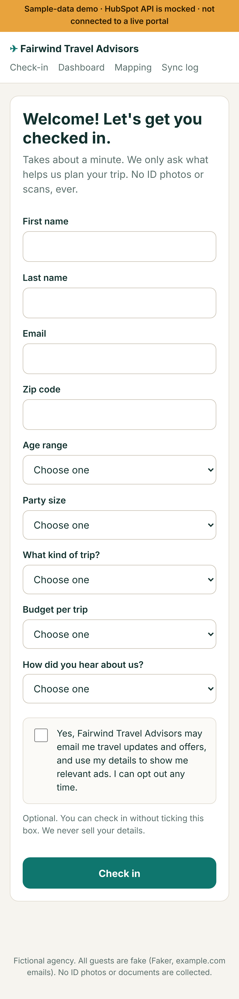
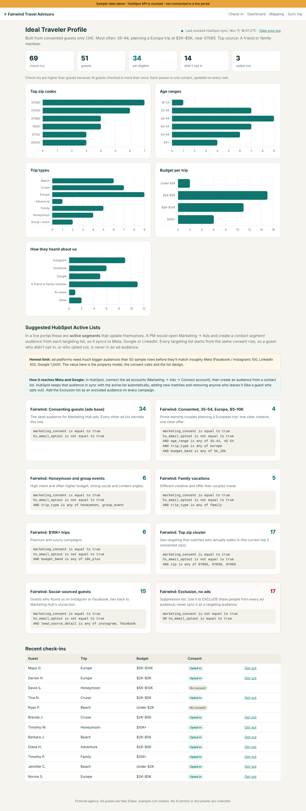
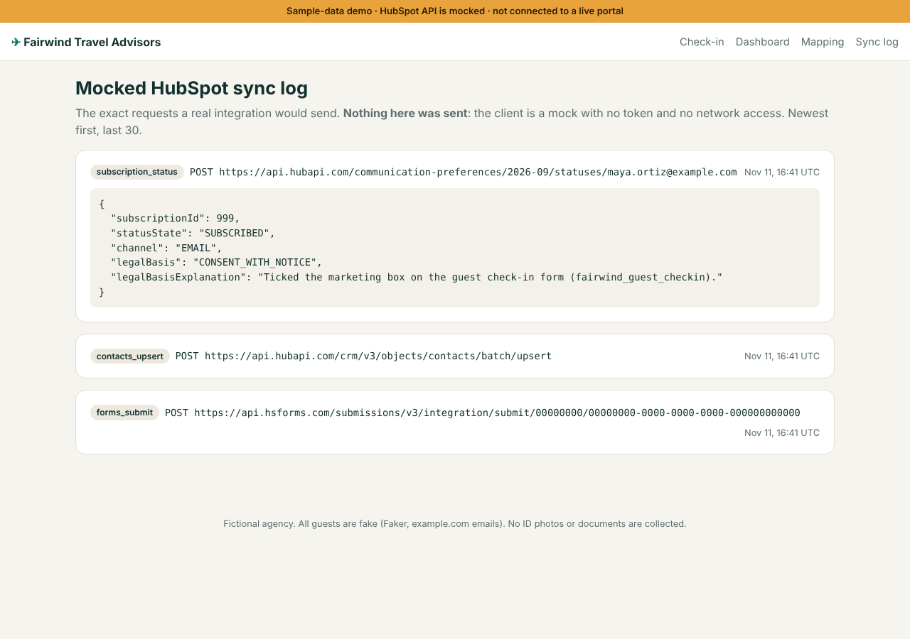

# Fairwind Travel Guest Check-in

> **Public portfolio demo · sample data only · HubSpot API is mocked.**
> Fairwind Travel Advisors is a fictional agency. Every guest is fake (Faker, `example.com` emails). The app is
> not connected to a live HubSpot portal or any client account, and it refuses to start in "live" mode.
>
> **Live demo:** _add the Render URL here after deploying_

Built on patterns from the production lead system I run for my own business: consent capture, CRM property
mapping, and idempotent upserts by email. The code here is a fresh, standalone build with sample data.

A mobile-friendly guest check-in for a travel agency. It turns walk-in patterns into an **Ideal Traveler
Profile** and **suggested HubSpot active lists** that a project manager would sync into Marketing Hub's ads tool,
**only for guests who opted in.**

**The problem it solves:** travel owners often guess who's walking through the door, then aim paid ads at a
generic crowd. A simple, consent-first check-in fixes that: it shows who actually comes in and which audiences are
worth advertising to.

| Check-in (phone) | Ideal Traveler Profile | Mocked HubSpot sync log |
|---|---|---|
|  |  |  |

<!-- Screenshot placeholders: replace with fresh captures from your deployed demo if you restyle it. -->

## What it does

1. **Check-in form.** Phone-first, with first and last name, email, zip, age range, trip type, party size, budget
   band, and how they heard about us. **No ID photos, no ID scans, no date of birth, no street address.**
2. **Consent done properly.** The marketing box is **unchecked by default** and optional; guests can check in
   without it. Every guest gets a one-click opt-out link, and there's an opt-out-by-email page plus a control on the
   dashboard. Opting out removes the guest from every ad audience, and they stay a contact for check-in history.
3. **HubSpot mapping.** Each submission maps to standard and custom contact properties (table below).
4. **Mocked HubSpot client.** It builds the **exact JSON** a real integration would send (Forms API submit, CRM batch
   upsert by email, and a Communication Preferences subscribe or unsubscribe) and writes it to a **sync log** you
   can show on screen. It has no token and no network calls.
5. **Ideal Traveler Profile.** Top zips, age ranges, trip types, budget bands and sources, drawn from
   **consented guests only**, with Chart.js bars and a one-line summary.
6. **Suggested HubSpot active lists.** These include "Consented, 35–54, Europe, $5–10K", honeymoon and groups,
   family, $10K+, the top zip cluster, social-sourced guests, and an **exclusion list**. Filter rules are written the
   way you'd set them in HubSpot, and member counts come from the same rules run locally.
7. **Seed data.** 50 deterministic fake guests with mixed consent, including two later opt-outs and one guest
   unsubscribed in HubSpot.

## The consent rule

Every ad-audience list starts from the same base filter:

```
marketing_consent is equal to true
AND hs_email_optout is not equal to true
```

So a guest who didn't tick the box, or who opted out later, **can never be in an ad audience**. They show up only
in the operational totals and in the **Exclusion, no ads** suppression list, which you use to exclude people, never
as a targeting audience. The tests prove this.

## HubSpot property mapping

| Form field / value | Internal name | Standard / custom | Type | Notes |
|---|---|---|---|---|
| First name | `firstname` | Standard | string | Required |
| Last name | `lastname` | Standard | string | Required |
| Email | `email` | Standard | string | Upsert key (`idProperty=email`) |
| Zip code | `zip` | Standard | string | 5-digit US |
| Legal basis | `hs_legal_basis` | Standard | enumeration | `Freely given consent from contact`, **only** when the box was ticked. Never "legitimate interest" as a stand-in. |
| New contact | `lifecyclestage` | Standard | enumeration | `lead` on first check-in only; never overwrites a later stage |
| Age range | `age_range` | **Custom** | enumeration | `18-24` … `65+` |
| Trip type | `trip_type` | **Custom** | enumeration | `beach`, `cruise`, `europe`, `adventure`, `family`, `honeymoon`, `group_event` |
| Party size | `party_size` | **Custom** | enumeration | `1`, `2`, `3-4`, `5-8`, `9+` |
| Budget band | `budget_band` | **Custom** | enumeration | `under_2k`, `2k_5k`, `5k_10k`, `10k_plus` |
| How they heard about us | `lead_source_detail` | **Custom** | enumeration | `instagram`, `facebook`, `google`, `referral`, `event`, `other` (not written to `hs_analytics_source`, which HubSpot sets itself) |
| Marketing consent | `marketing_consent` | **Custom** | boolean checkbox | `true` only if ticked |
| Consent date | `marketing_consent_date` | **Custom** | datetime | Set on opt-in, updated on opt-out |
| Consent source | `marketing_consent_source` | **Custom** | string | `fairwind_guest_checkin` |
| Last check-in | `last_checkin_date` | **Custom** | datetime | Every visit |
| External id | `external_guest_id` | **Custom** | string, unique | Idempotency key |

`hs_email_optout` and `hs_marketable_status` are set by HubSpot. This app only **reads** `hs_email_optout` in list
filters and never pretends to set either one.

**In production:** submissions would go through the **Forms API** with `legalConsentOptions` (preferred, because
forms record notice, consent and subscriptions), falling back to **CRM `batch/upsert` by email** plus the
**Communication Preferences API** (`SUBSCRIBED` / `UNSUBSCRIBED`, `legalBasis=CONSENT_WITH_NOTICE`). All three
request shapes are in [`app/hubspot/mock.py`](app/hubspot/mock.py) and on the `/sync-log` page. Custom properties
would be created once (`POST /crm/v3/properties/contacts`). Deleting a contact in HubSpot also removes it from
synced ad audiences, which a live build should rely on for deletion requests.

## Honest limits

- **Sample data and a mocked API.** I haven't run this for a travel-agency client. It's a demo of how I'd collect
  guest patterns with consent and turn them into Marketing Hub ad audiences.
- **Audience minimums.** Ad platforms need far bigger audiences than 50 rows before they'll match (roughly
  Meta 100, LinkedIn 300, Google 1,000). The value is the property model, the consent rules and the list design.
- **No auth on the dashboard.** It's a public demo with fake data. A real deployment would put it behind HubSpot
  or SSO login.
- **Application code, not a no-code workflow:** Python, FastAPI, SQLite.

## Run it locally

```bash
python3.12 -m venv .venv && source .venv/bin/activate
pip install -r requirements.txt
uvicorn app.main:app --reload        # seeds 50 fake guests on start (DEMO_MODE=1 by default)
```

Open http://localhost:8000 for the check-in form, `/dashboard` for the profile and lists, `/mapping` for the property
table, and `/sync-log` for the mocked payloads.

```bash
pytest            # all 41 tests pass
```

## Deploy to Render (free)

1. Push this folder to a GitHub repo.
2. In Render: **New → Blueprint**, pick the repo. `render.yaml` creates one free web service with
   `DEMO_MODE=1`, `CRM_MOCK=true` and a generated `SECRET_KEY`.
3. Wait for the build, then open the URL. Free instances sleep when idle, so the first load can take ~30 seconds.

The SQLite file lives on the instance and reseeds on every boot, which is fine for a demo.

## Project layout

```
app/
  main.py          routes, CSRF, security headers
  config.py        settings (refuses to start unless CRM_MOCK=true)
  schemas.py       Pydantic validation of the form
  choices.py       answer lists (= HubSpot enumeration options)
  models.py        Guest and SyncLog tables
  guests.py        upsert by email, consent and opt-out rules
  mapping.py       guest → HubSpot contact properties
  hubspot/mock.py  the mocked client (Forms, CRM upsert, subscriptions)
  segments.py      suggested active lists + the consent base filter
  profile.py       Ideal Traveler rollups (consented only)
  seed.py          50 deterministic fake guests
templates/         Jinja2 pages
static/            CSS, dashboard.js, self-hosted Chart.js 4.4.7 (MIT)
tests/             pytest: form, mapping, consent, opt-out, dashboard
```

## Privacy by design

- Collects the minimum: no ID images or documents, no date of birth, no street address. Age range and zip are
  enough to describe an audience.
- Consent is explicit, informed, off by default, and easy to withdraw.
- No tracking pixels. Strict Content-Security-Policy with no inline scripts and nothing loaded from other sites.
- CSRF tokens and a honeypot on every form.

---

License: view and evaluate only (see [LICENSE](LICENSE)). Chart.js is MIT.

Built by Kevin Gaviria · [LinkedIn](https://www.linkedin.com/in/kevin-gaviria)
